# Design system lalakode

Lý do của từng lựa chọn: ADR 0008. Xem trực tiếp mọi token và component: chạy `npm run dev` rồi mở `/dev/design` (chỉ có ở dev).

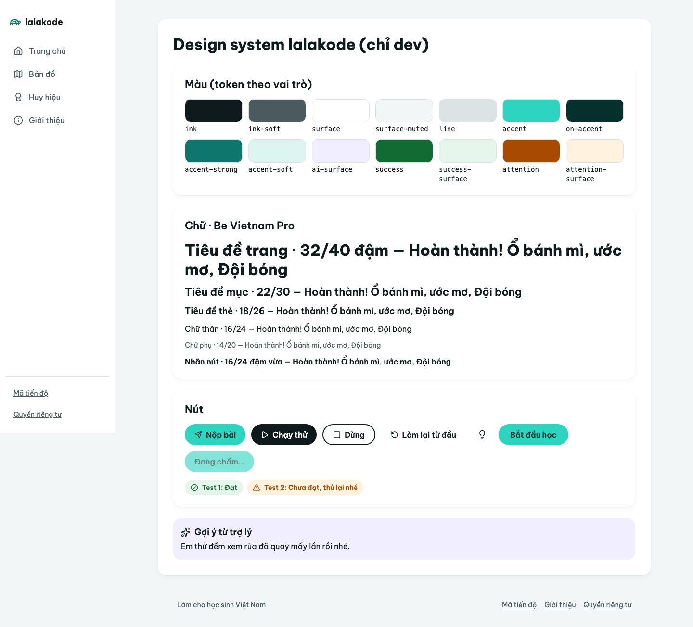

## Nguyên tắc

1. **Một màu nhấn duy nhất** (`accent`) cho hành động chính và mục đang chọn. Mọi thứ khác là đen, xám, trắng: trẻ nhìn là biết phải bấm đâu. Mỗi màn chỉ nên có một nút `primary`.
2. **Màu không bao giờ là tín hiệu duy nhất.** Đúng/sai, xong/chưa xong luôn kèm icon và chữ.
3. **Mọi chữ đạt WCAG AA (≥ 4.5:1)** trên nền của nó. `src/tokens.test.ts` đọc thẳng `index.css` và chốt điều này; thêm cách phối chữ/nền mới thì thêm cặp vào test.
4. **Mọi thứ AI tạo ra nằm trên nền `ai-surface`** (`AiPanel`), để trẻ luôn biết đâu là gợi ý của trợ lý.
5. Chỉ có giao diện sáng. Editor và console là ngoại lệ, luôn tối.

## Màu

Khai báo một chỗ duy nhất: `@theme` trong `apps/web/src/index.css`. Dùng qua class Tailwind (`bg-surface`, `text-ink-soft`, `border-line`…). Không viết mã màu trong component.

| Token | Giá trị | Dùng cho | Tương phản |
| --- | --- | --- | --- |
| `ink` | `#0F1A1C` | Chữ chính, nút `dark`, mục nav đang chọn, viền focus | 17.7:1 trên `surface` |
| `ink-soft` | `#4A5A5E` | Chữ phụ, mô tả, mục nav chưa chọn | 7.2:1 trên `surface` |
| `surface` | `#FFFFFF` | Thẻ, sidebar | — |
| `surface-muted` | `#F3F6F6` | Nền trang, khối phụ | — |
| `line` | `#DCE3E4` | Đường chia, viền thẻ | (không dùng cho chữ) |
| `accent` | `#2DD4BF` | Nút `primary`, con trỏ và vùng chọn trong editor | — |
| `on-accent` | `#06302B` | Chữ trên `accent` | 7.7:1 |
| `accent-strong` | `#0F766E` | Link, icon nhấn, chữ màu nhấn trên nền sáng | 5.5:1 trên `surface` |
| `accent-soft` | `#DDF5F1` | Nền nhạt cho thứ đang được làm nổi (số thứ tự bài, chuỗi ngày học, huy hiệu đã nhận) | `ink` 15.5:1, `accent-strong` 4.8:1 |
| `ai-surface` | `#F1EEFF` | Nền khung gợi ý AI | `ink` 15.5:1 |
| `success` | `#126B32` | Chữ/icon "đạt", "xong" | 6.6:1 trên `surface` |
| `success-surface` | `#E7F6EC` | Nền thẻ đạt | `success` 5.9:1 |
| `attention` | `#A64B00` | Chữ/icon "chưa đạt", lỗi thân thiện | 5.8:1 trên `surface` |
| `attention-surface` | `#FFF3E0` | Nền thẻ cần chú ý | `attention` 5.3:1 |

`accent` sáng nên **không đạt AA khi làm chữ trên nền trắng**. Chữ hay link mang màu nhấn thì dùng `accent-strong`.

## Chữ

Font **Be Vietnam Pro** (OFL), tự host ở `apps/web/public/fonts/be-vietnam-pro/` kèm `OFL.txt`. Độ đậm 400, 600, 700; mỗi độ đậm chia 3 file theo `unicode-range` (latin, latin-ext, vietnamese) nên trình duyệt chỉ tải phần cần. Code dùng font mono của hệ thống.

| Class | Cỡ / dòng | Đậm | Dùng cho |
| --- | --- | --- | --- |
| `text-page-title` | 32 / 40 | 700 | Tiêu đề trang (`h1`) |
| `text-section-title` | 22 / 30 | 600 | Tiêu đề mục (`h2`) |
| `text-card-title` | 18 / 26 | 600 | Tiêu đề thẻ, tên logo |
| `text-body` | 16 / 24 | 400 | Chữ thân (mặc định của `body`) |
| `text-small` | 14 / 20 | 400 | Chữ phụ. **Không nhỏ hơn 14px** |
| `text-label` | 16 / 24 | 600 | Nhãn nút, mục nav |

## Component (`apps/web/src/shared/ui/`)

| Component | Ghi chú |
| --- | --- |
| `Button` | `variant`: `primary` (hành động chính, ví dụ "Nộp bài"), `dark` ("Chạy thử"), `outline` ("Dừng"), `ghost` ("Làm lại từ đầu"). `size`: `md` (44px), `lg` (48px). `icon` đứng trước chữ. Mặc định `type="button"`. |
| `ButtonLink` | Link của router trông như nút. Dùng khi bấm là sang trang khác. |
| `buttonClasses()` | Class của nút, cho chỗ cần giữ thẻ riêng (ví dụ `<button>` có `ref`). |
| `IconButton` | Nút tròn 44×44 chỉ có icon; `label` bắt buộc (thành `aria-label`). |
| `Card` | Thẻ trắng bo 16px, bóng nhẹ, `as` = `div`/`section`/`article`/`li`. |
| `AiPanel` | Khung nền `ai-surface` cho nội dung do AI tạo. |

Mọi nút cao tối thiểu 44px (`min-h-tap`) và bo tròn hẳn. Viền focus: 3px `ink`, cách 2px — 17:1 trên nền trắng, 9.5:1 trên nút màu nhấn.

## Khung trang

| Màn | Bố cục |
| --- | --- |
| ≥ 1024px | Sidebar trắng 240px: logo rùa + tên, 4 mục nav dạng viên thuốc (đang chọn: nền `ink`, chữ trắng), dưới cùng là "Mã tiến độ" và "Quyền riêng tư". Nội dung trong thẻ trắng trên nền `surface-muted`. |
| < 1024px | Thanh trên cùng (tên + nút menu). Nút menu mở ngăn kéo chứa chính phần nav; chọn mục, bấm lại nút hoặc Esc thì đóng. |

Chọn **ngăn kéo thay vì thanh nav ở đáy** vì đáy màn hình điện thoại để dành cho thanh nút Chạy/Nộp của màn bài tập (S0-32); hai thanh dính đáy sẽ chồng nhau.

Footer (`contentinfo`) nằm cuối cột nội dung ở mọi khổ màn hình, để chỉ có một footer trên trang.

| Bản đồ, 1440px | Bản đồ, 820px | Menu mở, 390px |
| --- | --- | --- |
| 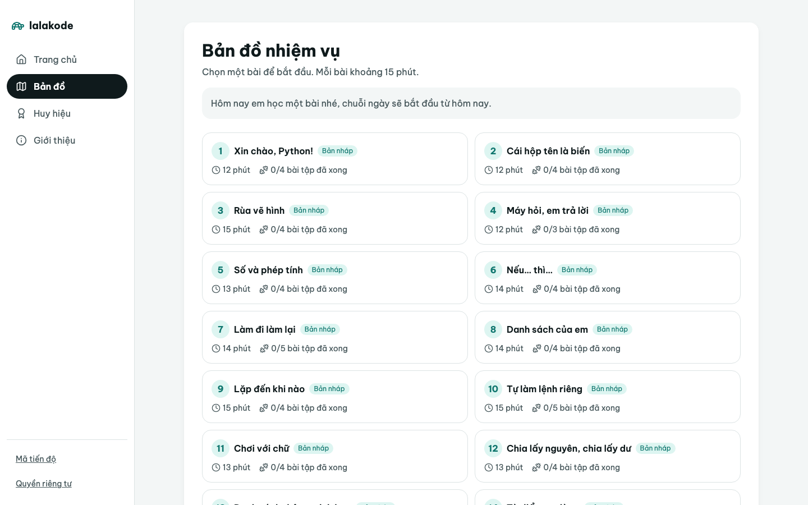 | 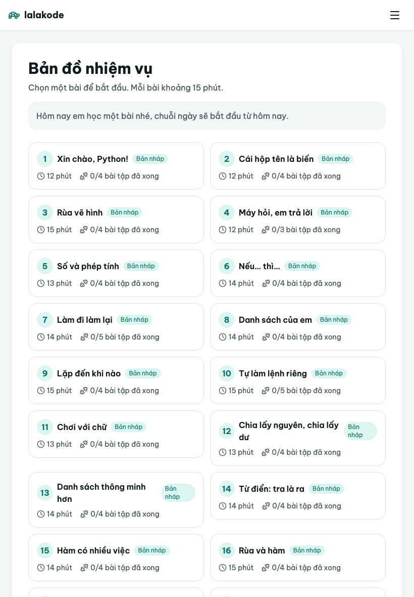 | 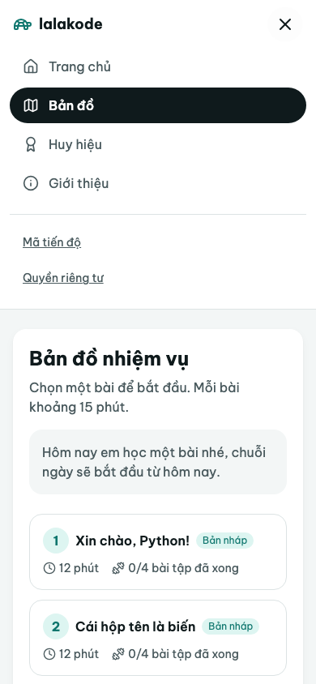 |

## Editor và console tối

Theme CodeMirror **tự viết** trong `apps/web/src/shared/ui/code-theme.ts` (không dùng `@codemirror/theme-one-dark` hay `basicSetup`, ADR 0007). Màu là token `--color-code-*` trong `index.css`; `tokens.test.ts` đòi mọi màu chữ đạt AA trên nền, dòng đang đứng và gutter. Khối `@theme` là `static` để các biến này luôn có mặt dù không class nào dùng.

| Token | Màu | Dùng cho | Tương phản trên `code-bg` |
| --- | --- | --- | --- |
| `code-bg` | `#0D1B1E` | Nền editor và console | — |
| `code-gutter` | `#122428` | Cột số dòng, thanh tiêu đề "Code của em" / "Kết quả chạy" | — |
| `code-active` | `#16292D` | Dòng đang đứng | — |
| `code-text` | `#E4F0F0` | Chữ thường, toán tử | 15.1:1 |
| `code-muted` | `#8DA2A6` | Số dòng, chữ chờ trong console | 6.6:1 |
| `code-keyword` | `#FF9AC1` | `import`, `for`, `if`, `def`, `in`… | 8.9:1 |
| `code-string` | `#A5E3A0` | Chuỗi | 11.8:1 |
| `code-number` | `#FFC57A` | Số, `True`/`False`/`None` | 11.3:1 |
| `code-comment` | `#9AAEB2` | Comment (trẻ đọc gợi ý trong code khởi đầu) | 7.6:1 |
| `code-function` | `#7CC6FF` | Gọi hàm, `turtle.forward` | 9.5:1 |
| `code-builtin` | `#5FE3D2` | `print`, `range`, `len`, `input`… (tô bằng `MatchDecorator` vì ngữ pháp Python không phân biệt) | 11.2:1 |

Con trỏ, viền focus 3px và vùng chọn (25% độ mờ) dùng `accent`. Cỡ chữ code 16px, 15px dưới 640px, dòng cao 1.6. Đang chạy (chỉ đọc): chữ mờ đi, con trỏ ẩn.

## Màn bài tập

| Màn | Bố cục |
| --- | --- |
| ≥ 1024px | Đề bài trong thẻ trên cùng (dài quá 180 ký tự thì có nút thu gọn). Dưới là 2 cột ~55/45, cao đúng phần còn lại của màn hình, **mỗi cột tự cuộn**: trái là editor tối (tối thiểu ~16 dòng) và thanh nút ngay dưới; phải là lỗi → kết quả chạy → hình rùa → kết quả chấm → gợi ý. |
| < 1024px | Xếp dọc: đề bài → editor → kết quả → gợi ý. Thanh nút **dính đáy màn hình**; dưới 640px nút "Làm lại từ đầu" chỉ còn icon để thanh nằm một hàng. |

Chạy/nộp xong: màn rộng cuộn cột phải lên đầu, màn hẹp cuộn trang tới khu kết quả (`prefers-reduced-motion` thì nhảy thẳng, không trượt). Khu kết quả có `aria-live="polite"`. Hình rùa vuông, rộng theo cột (tối đa 560px), vẽ theo `devicePixelRatio`; toạ độ vẫn tính trên khung 320×320 mà bài học viết theo.

Nút: "Nộp bài" `primary`, "Chạy thử" `dark`, "Dừng" `outline`, "Làm lại từ đầu" `ghost`.

| | 1440 | 1180 (tablet ngang) | 820 (tablet dọc) | 390 |
| --- | --- | --- | --- | --- |
| Trước | 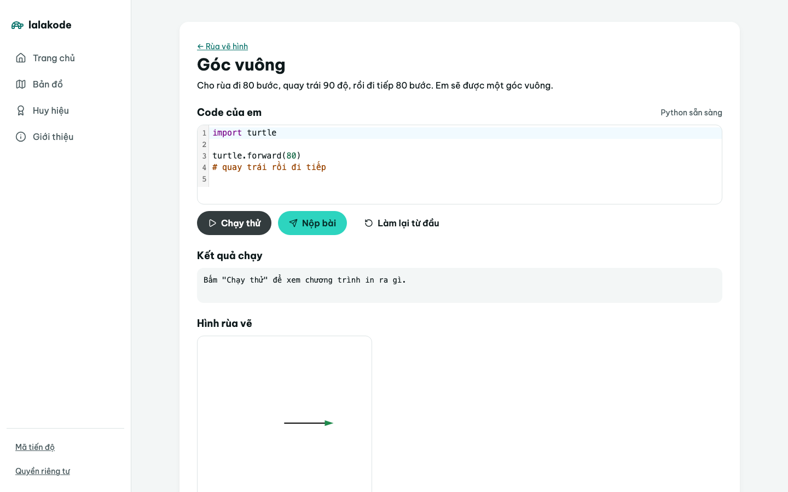 | — | 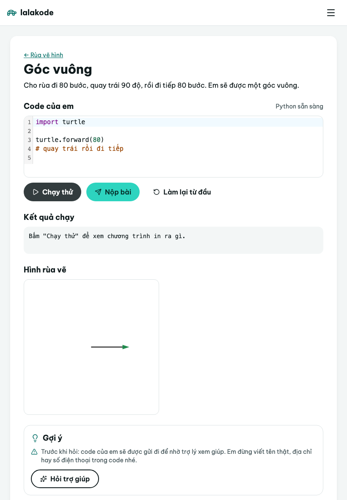 | 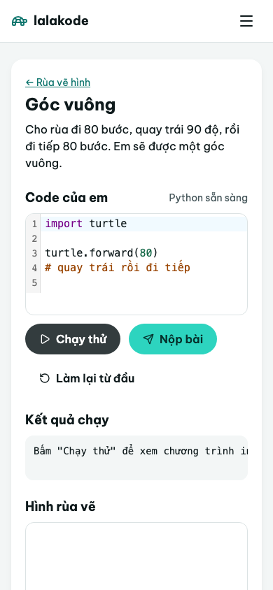 |
| Sau | 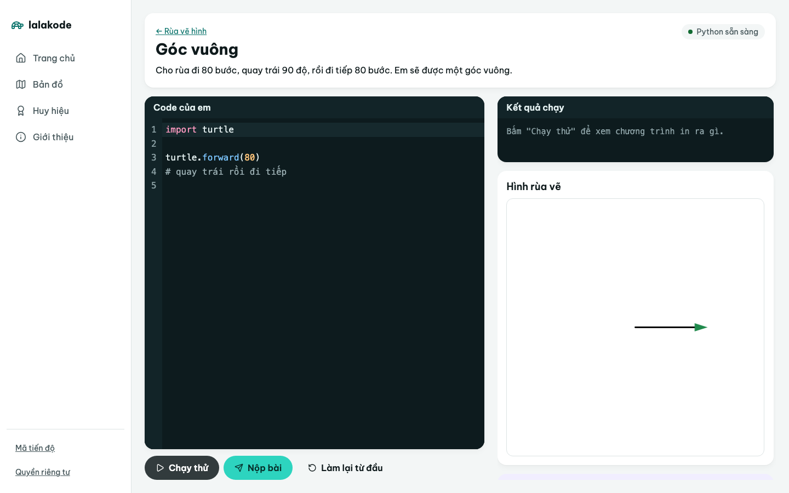 | 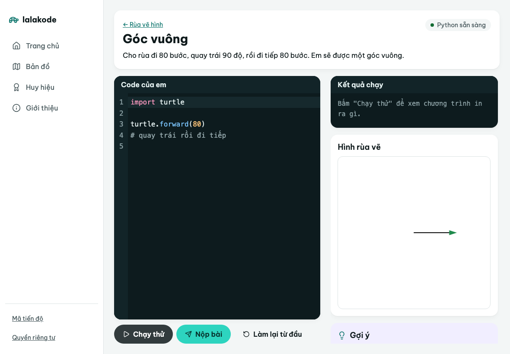 | 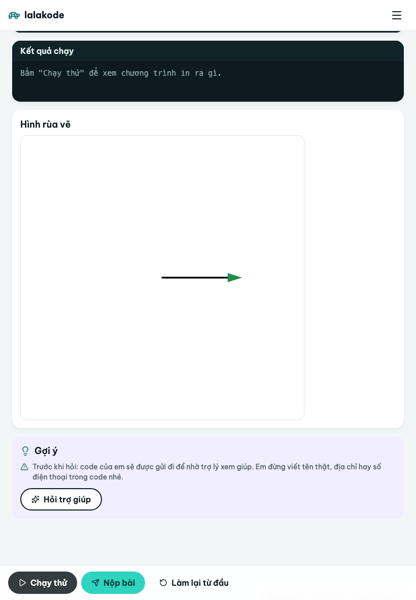 | 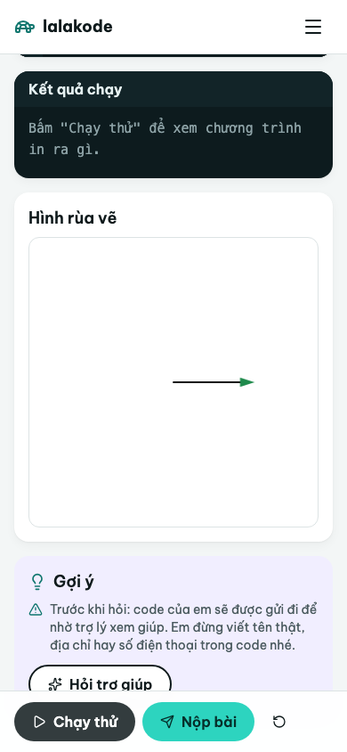 |
